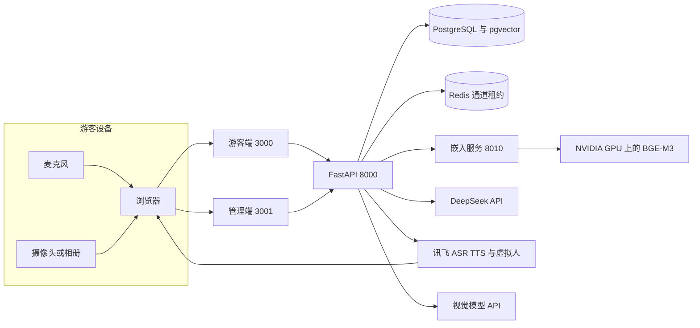

# 灵境智游

面向景区游客的 AI 数字人导览系统：浏览器里完成问答、语音、识景、路线陪伴和互动故事，管理端维护知识库与数字人配置。


## Demo


演示动图尚未放入仓库。文字版路径如下：

1. 打开游客端，选择数字人角色。
2. 用文字、麦克风或一张景区照片提问。
3. 系统检索已入库的景区知识，由大模型组织回答，并把文本交给讯飞虚拟人播报。
4. 打开路线页，按兴趣和时长生成行程；到站、跳过或感到疲劳时可以重规划。
5. 管理端使用 `.env` 中的管理员账号登录，查看知识库、数字人配置和运营分析。

没有对应的云账号、麦克风或 NVIDIA GPU 时，页面可以打开，但问答、语音和向量服务会报错或没有声音。请先看下面的架构和 `backend/app` 里的调用关系。

## 核心功能

- 游客端：文本、语音、图片问答，行程陪伴，互动故事，文创社区。
- 数字人：五个讯飞虚拟人角色。Redis 保证同一时刻只有一路 WebSDK 连接，游客优先。
- 问答：DeepSeek 生成回答，PostgreSQL/pgvector 保存知识，本地 BGE-M3 产生向量。回答长度分简答、普通和展开。
- 路线：按兴趣、位置、时长和体力筛选；进行中的行程保存在浏览器本地。
- 管理端：知识入库与复测、数字人配置、运营分析和用户管理。

## 系统与硬件架构



浏览器采集语音和图片，后端完成检索与生成，讯飞把回答渲染成数字人视频流返回浏览器。嵌入服务只在配置了本地模型时读取 GPU。

## 警告

> ⚠️ 本项目依赖实体硬件，无对应硬件直接运行可能报错或无输出，请重点参考算法逻辑与代码结构。

这里的硬件主要是一块用于本地向量的 NVIDIA GPU，以及浏览器可用的麦克风和摄像头。数字人、语音识别和视觉理解还依赖外部云服务。没有这些条件时，不要把启动失败理解成业务代码被改坏。

## 硬件清单

| 设备 | 数量 | 作用 | 接线 |
|------|------|------|------|
| 可运行 Docker 的电脑 | 1 | 游客端、管理端、API、数据库、Redis | 无外部接线，使用本机回环地址 |
| NVIDIA GPU | 1，可选 | 本地 BGE-M3 嵌入。`EMBEDDING_DEVICE=cuda` 且 Compose 申请全部 GPU | 使用宿主机 NVIDIA 驱动与容器运行时。无独立供电或引脚说明 |
| 麦克风 | 1，可选 | 浏览器语音提问 | 系统默认录音设备，由浏览器申请权限 |
| 摄像头或相册 | 1，可选 | 识景和文创点评 | 浏览器拍照，或直接上传图片 |

仓库里没有串口、GPIO 或定制电路板。具体显卡型号待作者核实。

## 快速开始

### 环境要求

- Docker Compose
- 可选：NVIDIA 驱动和 GPU 容器运行时。没有 GPU 时需要把嵌入相关配置改成 CPU 后再构建，见踩坑记录
- 可选：Node.js 20 与 Python 3.11，只在宿主机单独检查前端或后端时需要
- 云账号：DeepSeek、讯飞开放平台；图片能力另需阿里百炼或 Kimi

### 安装依赖

```powershell
docker compose up -d
```

这条命令会构建 API、游客端、管理端、PostgreSQL、Redis 和嵌入服务。

### 配置 .env

```powershell
Copy-Item .env.example .env
```

至少填写：

```dotenv
DEEPSEEK_API_KEY=
XFYUN_APP_ID=
XFYUN_API_KEY=
XFYUN_API_SECRET=
XFYUN_AVATAR_SCENE_ID=
VISION_API_KEY=
ADMIN_PASSWORD=
JWT_SECRET=
```

密钥获取位置写在 `.env.example` 和 `backend/app/config.py` 的注释里。形象 ID、音色和虚拟人地域地址只有在新账号没有授权原资源时才需要改。修改后重建 API 容器：

```powershell
docker compose up -d --force-recreate api
```

### 运行

```powershell
docker compose exec api python -m scripts.init_db
docker compose exec api python -m scripts.init_data
docker compose exec api python -m scripts.init_storylines
docker compose exec api python -m scripts.ingest_knowledge
docker compose run --rm embedding-worker
```

| 服务 | 地址 |
|------|------|
| 游客端 | http://127.0.0.1:3000 |
| 管理后台 | http://127.0.0.1:3001 |
| 后端 API | http://127.0.0.1:8000/docs |
| 嵌入服务 | http://127.0.0.1:8010/health |

管理账号来自 `ADMIN_USERNAME` 和 `ADMIN_PASSWORD`。

需要非零的演示图表和社区样例时，可以再执行 `scripts.seed_demo_analytics` 与 `scripts.seed_community_showcase`。这些是固定的示范数据，不是景区经营数据。

## 踩坑记录

以下各项均从当前代码和 Compose 配置推断，逐条待作者核实。

1. 嵌入服务声明 `gpus: all`，默认镜像和轮子都是 CUDA。没有 NVIDIA 驱动时，`embedding-service` 会不健康，API 也会一直等待。待作者核实。
2. `models/bge-m3` 不在仓库里。目录为空时，向量接口没有模型输出。待作者核实。
3. 讯飞虚拟人同一账号同时只允许一路连接。游客页未关闭时，管理端预览和健康检查会显示占用，而不是密钥错误。待作者核实。
4. Windows 上 Compose 已打开 `CHOKIDAR_USEPOLLING`。关掉轮询后，挂载卷里的前端改动可能不热更新。待作者核实。
5. 语音依赖浏览器麦克风权限。页面被系统静音、非本地环境被浏览器拦截录音时，没有音频进入 ASR。待作者核实。
6. 数据库默认账号是 `user` / `pass`，只适合本机 Compose。暴露到公网前必须同时修改 Compose 和 `DATABASE_URL`。待作者核实。
7. `JWT_SECRET` 的代码默认值是开发占位字符串。公网部署沿用它时，管理端令牌可以被伪造。待作者核实。
8. 视觉模型的供应商、地址和密钥必须成套。百炼、Kimi 开放平台和 Kimi Code 不能混用。待作者核实。
9. 仓库中没有波特率、串口、GPIO 或外部供电电路。如果现场另有闸机、定位基站或功放，接线方式待作者核实。

## 大文件

以下内容故意不放入 Git：

| 内容 | 大约体积 | 下载方式 |
|------|----------|----------|
| BGE-M3 权重 | 约 2GB | 从 Hugging Face 模型页 [BAAI/bge-m3](https://huggingface.co/BAAI/bge-m3) 下载到 `models/bge-m3`。GitHub Release 或网盘镜像：占位，待作者上传后替换本句 |
| 原始景区 Word/Excel | 约 16MB | 不参与默认入库。规范化结果已在 `backend/scripts/a5_official_materials.json` |
| 演示视频 | 可能超过 100MB | 本机保留，不提交。发布页视频：占位，待作者上传后替换本句 |

## 项目结构

```text
backend/        FastAPI、检索、对话、定位、故事、讯飞接口
frontend/       游客端
admin-web/      管理端
init-scripts/   PostgreSQL 初始化
models/         本地模型目录，不提交
```

直接依赖是 MIT、BSD、Apache-2.0 或 PostgreSQL License，没有发现必须改用 Copyleft 的组件，因此仓库使用 MIT。`frontend/src/vendor/avatar-sdk-web` 和 `admin-web/src/vendor/avatar-sdk-web` 是讯飞 WebSDK 构建产物，权利归讯飞所有，根目录 MIT 不覆盖这两处。

## 本地检查

不启动 GPU 和云服务时，可以只做语法和类型检查：

```powershell
Set-Location backend
pip install -r requirements-dev.txt
python -m compileall -q .
python -m unittest discover -s tests -v
Set-Location ../frontend
npx tsc --noEmit
Set-Location ../admin-web
npx tsc --noEmit
```
